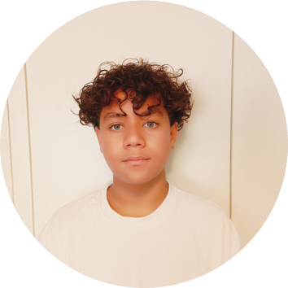

<p align="center">
  
</p>

<h1 align="center">Kingston Luthi · Portfolio</h1>

<p align="center">
  Futur <strong>Interactive Media Designer CFC</strong> · Canton de Vaud · Dès août 2027<br>
  <a href="https://kingstonluthi.ch">kingstonluthi.ch</a>
</p>

---

## 👋 À propos

J'ai 15 ans et je cherche une place d'apprentissage d'Interactive Media Designer CFC.
Ce site présente mes montages vidéo, mon parcours et mes stages.

C'est aussi mon premier projet web : je l'ai créé avec l'aide d'une intelligence artificielle, puis mis en ligne moi-même avec GitHub Pages et mon propre nom de domaine.

## 🛠️ Technologies

HTML · CSS · JavaScript · Git · GitHub Pages

Aucune installation nécessaire : pour voir le site, il suffit d'ouvrir `index.html` dans un navigateur.

## 📁 Organisation

```
├── index.html          → le contenu du site (textes, projets, contact)
├── css/style.css       → le design (couleurs, polices, mise en page)
├── js/main.js          → les interactions (menu, vidéos, animations)
└── assets/             → images, vidéos et CV
```

## ✏️ Modifier le site

- **Textes** : dans `index.html`, chaque partie est signalée par un commentaire (`PROJETS`, `À PROPOS`…).
- **Couleurs et polices** : dans les variables au début de `css/style.css`.
- **Ajouter une vidéo** : mettre le fichier dans `assets/videos/`, sa miniature dans `assets/images/`, puis copier un bloc `<article class="project-card">` dans `index.html` et l'adapter.

## © Droits

© Kingston Luthi. Tous droits réservés.
Les vidéos, images, textes et le CV ne peuvent pas être réutilisés sans mon accord.
